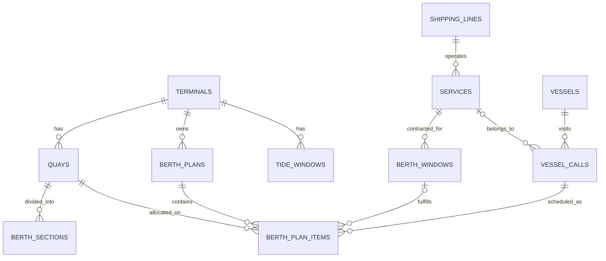

Mình đề xuất không chỉ tách thành `vessel/call/window`, mà chia Berth Window thành 4 lớp: hạ tầng, dữ liệu danh mục, cửa sổ cam kết lặp tuần, và kế hoạch khai thác có phiên bản.

## 1. Vấn đề của mô hình JSON hiện tại

Một row JSON phù hợp cho prototype, nhưng có các giới hạn:

- Mỗi lần sửa phải ghi đè toàn bộ dataset.
- Hai planner cùng sửa có thể ghi đè dữ liệu của nhau.
- Không truy vấn hiệu quả theo tàu, tuyến, tuần hoặc cầu bến.
- Không có foreign key và tính nhất quán giữa vessel/service/window.
- Không lưu được lịch sử các bản kế hoạch đã phát hành.
- `window` đang bị lặp trong từng call dù về nghiệp vụ nó là cam kết định kỳ của tuyến.
- `ata` trong frontend thực tế đang được dùng làm thời điểm bắt đầu chiếm cầu, không đúng nghĩa ATA.
- Nút chuyển tuần hiện chỉ đổi nhãn ngày; cùng một dataset được lặp lại cho mọi tuần.

Điểm cần lưu ý: B1–B3 nên được hiểu là các phân đoạn của một tuyến cầu dài 900 m. Một tàu có thể chiếm `0–350 m`, tức là đi qua ranh giới B1/B2. Vì vậy allocation phải gắn với `quay`, không được ép gắn vào một `berth_section`.

## 2. Mô hình đề xuất




### Nhóm hạ tầng

| Bảng | Vai trò |
|---|---|
| `terminals` | Terminal, múi giờ, safety gap mặc định |
| `quays` | Một tuyến cầu vật lý, ví dụ cầu dài 900 m |
| `berth_sections` | Các đoạn B1: 0–300, B2: 300–600, B3: 600–900 |
| `tide_windows` | Khung triều theo timestamp thực |

### Nhóm danh mục

| Bảng | Vai trò |
|---|---|
| `shipping_lines` | Hãng tàu |
| `services` | Tuyến dịch vụ CIX, VTX, MCS... |
| `vessels` | Tàu vật lý, IMO, LOA, beam, mớn nước thiết kế |

### Nhóm hợp đồng Berth Window

`berth_windows` là mẫu lặp hằng tuần:

```text
service_id
quay_id
weekday              0 = Monday
start_minute          08:30 = 510
duration_minutes
quay_from_m
quay_to_m
tolerance_early_min
tolerance_late_min
min_cranes
committed_bmph
valid_from
valid_to
```

Không ghi đè window khi tái đàm phán. Đóng bản cũ bằng `valid_to` và tạo row mới để giữ lịch sử hợp đồng.

### Nhóm lượt tàu thực tế

`vessel_calls` đại diện cho một lần tàu ghé cảng:

```text
call_code
vessel_id
service_id nullable
voyage_in
voyage_out
eta_at
ata_at
etb_at
atb_at
etd_at
atd_at
declared_draft_m
expected_moves
status
```

Phân biệt rõ:

- `ETA/ATA`: đến vùng neo hoặc vùng cảng.
- `ETB/ATB`: dự kiến/thực tế cập cầu.
- `ETD/ATD`: dự kiến/thực tế rời cầu.

Tàu vãng lai có `service_id = NULL` và không cần `berth_window_id`.

### Nhóm kế hoạch và versioning

`berth_plans`:

```text
terminal_id
week_start
version
status               draft | published | superseded
parent_plan_id
safety_gap_m
lock_version
change_reason
created_by
created_at
published_by
published_at
```

`berth_plan_items`:

```text
plan_id
vessel_call_id
berth_window_id nullable
quay_id
planned_start_at
planned_end_at
quay_from_m
quay_to_m
crane_count
planned_moves
note
```

Một kế hoạch đã `published` phải bất biến. Khi chỉnh sửa:

1. Clone plan thành version mới.
2. Sửa version mới ở trạng thái `draft`.
3. Validate.
4. Publish version mới.
5. Chuyển version cũ sang `superseded`.

Cơ chế này trả lời được câu hỏi: “Bản kế hoạch được phát hành tại thời điểm X ghi nhận tàu nằm ở đâu?”

## 3. Các ràng buộc quan trọng

Database có thể kiểm tra trực tiếp:

- `quay_from_m >= 0`
- `quay_to_m > quay_from_m`
- `planned_end_at > planned_start_at`
- `crane_count > 0`
- `duration_minutes > 0`
- `weekday BETWEEN 0 AND 6`
- `start_minute BETWEEN 0 AND 1439`
- `UNIQUE(plan_id, vessel_call_id)`
- `UNIQUE(terminal_id, week_start, version)`

Các ràng buộc cần service nghiệp vụ kiểm tra trong transaction:

- Allocation không vượt chiều dài quay.
- LOA cộng safety gap không vượt đoạn được cấp.
- Chồng thời gian và không gian giữa hai plan item.
- Mớn nước so với berth section và thủy triều.
- Window adherence.
- Năng lực cẩu và BMPH.
- Không cho sửa plan đã publish.
- Optimistic locking bằng `lock_version`.

Xung đột không nên lưu thành cờ cố định trong `berth_plan_items`; nó là kết quả tính toán. Nếu cần audit việc publish, có thể lưu thêm `plan_validation_runs` và `plan_validation_issues`.

## 4. Mapping dữ liệu JSON hiện tại

| JSON hiện tại | Database mới |
|---|---|
| `terminal` | `terminals.name` |
| `berths[]` | `berth_sections` |
| `tideWindows[]` | `tide_windows` với timestamp thật |
| `call.id` | `vessel_calls.call_code` |
| `vessel`, `loa` | `vessels` |
| `service` | `services` |
| `line` | `shipping_lines` |
| `window` | `berth_windows` |
| `ata` | `berth_plan_items.planned_start_at` trong dữ liệu hiện tại |
| `dur` | chênh lệch `planned_start_at/planned_end_at` |
| `from/to` | `berth_plan_items.quay_from_m/quay_to_m` |
| `draft` | `vessel_calls.declared_draft_m` |
| `cranes` | `berth_plan_items.crane_count` |
| `moves` | `vessel_calls.expected_moves` hoặc snapshot trong plan item |
| `tol` | tolerance của `berth_windows` |

Riêng `ata` cần đổi tên theo đúng nghiệp vụ. Dựa trên logic hiện tại tại [berth-window.js](/Users/macbook/Desktop/mpc_ops_service/public/js/berth-window.js:103), nó là thời gian bắt đầu khối khai thác, phù hợp với `planned_start_at` hoặc `ETB`, không phải `ATA`.

## 5. Phạm vi MVP nên triển khai

Để tránh over-engineering, phiên bản đầu cần 11 bảng:

1. `terminals`
2. `quays`
3. `berth_sections`
4. `shipping_lines`
5. `services`
6. `vessels`
7. `berth_windows`
8. `tide_windows`
9. `vessel_calls`
10. `berth_plans`
11. `berth_plan_items`

Chưa cần ngay:

- Danh mục từng cẩu và phân công từng cẩu.
- AIS observation history.
- EDI message log.
- Audit theo từng field.
- Thuật toán tối ưu tự động.

## 6. Lộ trình migration an toàn

1. Tạo schema mới, giữ nguyên `berth_window_datasets`.
2. Viết migration nhận `weekStart` để chuyển `day/hour` thành timestamp thực.
3. Import toàn bộ JSON trong một transaction.
4. Viết repository/service đọc schema mới.
5. Giữ response DTO giống JSON cũ để frontend vẫn chạy.
6. Sau đó sửa chuyển tuần để gọi dữ liệu theo `weekStart`.
7. Khi API mới ổn định, chuyển bảng JSON thành read-only backup.
8. Cuối cùng mới loại bỏ fallback seed bị trùng ở frontend.

Thiết kế này vẫn phù hợp với SQLite hiện tại. Khi tải hoặc số người dùng tăng, schema cũng có thể chuyển sang PostgreSQL mà không phải thiết kế lại.

Giả định mình đang dùng để chốt thiết kế là: hệ thống trước mắt quản lý một terminal, một tuyến quay liên tục 900 m, nhiều phân đoạn B1–B3, và bắt buộc giữ lịch sử kế hoạch đã publish. Chưa có thay đổi code hay database trong bước phân tích này.w